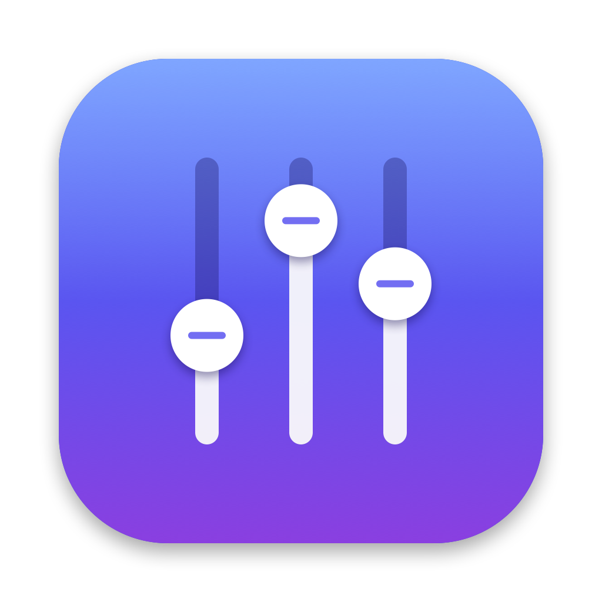

<p align="center">
  
</p>

# Volume Mixer for macOS

[](https://github.com/dracuthang2000/Volume-mixer/actions/workflows/build.yml)
[](LICENSE)


A menu-bar app that gives every app its own volume slider and mute button, inspired by the
**Volume Mixer** in Windows. Native Swift, no drivers, no dependencies. Free and open source.

```
┌──────────────────────────────────────┐
│ 🔊 MacBook Pro Speakers              │
│ 🔈 System        🔉 ━━━━━━━━○──  72  │
│──────────────────────────────────────│
│ Applications                         │
│ 🌐 Google Chrome ● 🔉 ━━━━○─────  45  │
│ 🎵 Spotify       ● 🔉 ━━━━━━━━━○ 100  │
│ 💬 Discord         🔇 ━━━━━━━○──  80  │
│──────────────────────────────────────│
│ Sound Settings…                Quit  │
└──────────────────────────────────────┘
```

- **System** row: the volume and mute of your current output device.
- **One row per app** that is playing sound. A green dot means it is playing right now.
  Helper processes (Chrome tabs, Safari's web content, Electron helpers) are grouped under
  their app.
- Per-app settings are **remembered** and applied again the next time the app plays.
- Switching output device (for example to AirPods) is handled automatically.

## Download

**With Homebrew:**

```bash
brew install --cask dracuthang2000/tap/volume-mixer
```

**Or manually:** get the latest `Volume-Mixer-vX.Y.Z.zip` from
[**Releases**](https://github.com/dracuthang2000/Volume-mixer/releases), unzip it, and move
**Volume Mixer.app** to Applications.

The app isn't notarized by Apple yet, so macOS blocks it the first time:

- **macOS 15 or later:** open the app once and close the warning. Then go to
  **System Settings → Privacy & Security**, scroll down, click **Open Anyway** next to
  "Volume Mixer", and confirm.
- **macOS 14:** right-click the app and choose **Open** → **Open**.

If macOS says the app "is damaged", run this once instead:

```bash
xattr -dr com.apple.quarantine "/Applications/Volume Mixer.app"
```

Or build it yourself (below). It only takes a minute.

## Requirements

| | |
|---|---|
| macOS | **14.2 or later** (uses Core Audio process taps) |
| Tools | Xcode **or** just the Command Line Tools (`xcode-select --install`) |
| Language | Swift 6 toolchain (the code builds in Swift 5 language mode) |

## Build and run

```bash
git clone https://github.com/dracuthang2000/Volume-mixer.git
cd Volume-mixer
./scripts/build-app.sh
```

```bash
open "build/Volume Mixer.app"
```

A slider icon appears in the menu bar. Click it to open the mixer.

> Always run the **bundled app**, not `swift run`. macOS needs the `Info.plist` inside the
> bundle to show the audio permission prompt. Without it the app is killed when it first
> taps audio.

### First use: permission

The first time you lower an app below 100% or mute it, macOS asks to let **Volume Mixer**
record system audio. Click **Allow**. If you clicked Don't Allow, turn it on in
**System Settings → Privacy & Security → Screen & System Audio Recording**
(the "System Audio Recording Only" list).

The build is signed ad hoc, so macOS may ask again after each rebuild.

### Start at login (optional)

Copy `build/Volume Mixer.app` to `/Applications`, then add it in
**System Settings → General → Login Items**.

## How it works

macOS has no built-in volume control per app, so the app redirects each app's sound through
itself:

```
 App (e.g. Chrome) ──audio──► [ Process tap ]  (original output muted while tapped)
                                    │
                                    ▼
                     [ Private aggregate device ]
                       input  = the tap
                       output = your real speakers
                                    │
                         IO callback: sample × gain
                                    ▼
                              🔊 Speakers
```

1. **Process tap** (`CATapDescription` + `AudioHardwareCreateProcessTap`) captures the
   audio of one app's processes. With `muteBehavior = .mutedWhenTapped`, the app's normal
   output is silenced while we read the tap, so you never hear it twice.
2. **Aggregate device** (`AudioHardwareCreateAggregateDevice`) is a private, invisible
   device that combines the tap as input with the current speakers as output.
3. **IO callback** copies input to output, multiplied by the gain. Changes are ramped over
   one buffer so moving the slider doesn't click.

A tap is created **only when needed** (volume below 100% or muted) and only while the app is
playing. Apps at 100% are left completely untouched, with no added latency or CPU.

The slider value is squared before use (`gain = slider²`), which feels closer to how loudness
is heard than a linear scale.

## Project layout

```
Volume-mixer/
├── Package.swift                  Swift package (macOS 14.2+)
├── Resources/Info.plist           Bundle info: menu-bar-only app, audio permission text
├── Resources/AppIcon.icns         App icon (AppIcon-1024.png is the full-size preview)
├── scripts/build-app.sh           Builds and signs "build/Volume Mixer.app"
├── scripts/make-icon.sh           Regenerates the icon from scripts/make-icon.swift
├── scripts/make-social-preview.swift  Draws docs/social-preview.png (GitHub link preview)
├── Sources/VolumeMixer/
│   ├── VolumeMixerApp.swift       @main entry: MenuBarExtra + AppDelegate
│   ├── MixerView.swift            SwiftUI interface (System row + one row per app)
│   ├── MixerModel.swift           State: polls processes, groups by app, starts/stops taps
│   ├── AppAudioTap.swift          Tap + aggregate device + real-time gain callback
│   ├── AppIdentity.swift          Maps a process ID to its app's name, icon and key
│   ├── AppSettings.swift          Saves per-app volume and mute in UserDefaults
│   └── CoreAudioHelpers.swift     Small wrappers around the C Core Audio API
├── docs/DEVELOPMENT.md            Developer notes, debugging, roadmap
├── LICENSE                        MIT
└── CLAUDE.md                      Context for Claude Code
```

## Known limitations

- **macOS 14.2+ only.** Older systems would need a virtual audio driver instead
  (the approach used by BackgroundMusic).
- Volume can only go **down** to 0–100% of the app's own level. There's no boost above 100% yet.
- Apps that play straight to a specific device, bypassing the default output, are tapped
  but replayed on the default output.
- Moving the slider from 100% creates the tap, which can cause a very short audio gap the
  first time.
- Grouping Safari's web audio under Safari uses an undocumented system function. If it is
  unavailable, that audio shows up as a separate "WebKit" row.

## Troubleshooting

| Problem | Fix |
|---|---|
| App goes silent when I lower its volume | Audio permission was denied. Enable it in Privacy & Security (see above), then quit and reopen Volume Mixer. |
| Red error text in the mixer | It names the app and the Core Audio error code. Usually permission, or the output device was disconnected. |
| An app isn't listed | It only appears while playing, and for 20 seconds after it stops. |
| System slider is greyed out | That output device (some HDMI/USB devices) has no software volume control. |

## Contributing

Contributions are welcome: bug reports, ideas, and pull requests. Please read
[CONTRIBUTING.md](CONTRIBUTING.md) and follow the [Code of Conduct](CODE_OF_CONDUCT.md).
Report security issues privately as described in [SECURITY.md](SECURITY.md).

## License

[MIT](LICENSE) © 2026 dracuthang2000
